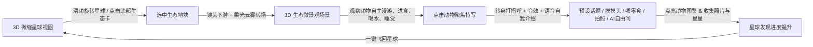

# 《万象星野》Web 3D 儿童动物星球 — 完整策划与技术规划

## 1. 立项决策总览

| 决策项 | 已确定方案 | 设计落地要点 |
| :--- | :--- | :--- |
| **目标平台** | **Web 3D（浏览器直玩）** | Vite + Three.js + 原生 HTML/CSS/JS，支持鼠标拖拽与手机/平板触控滑动，零安装打开即玩 |
| **目标受众** | **儿童（4–10 岁 / 亲子）** | 阳光绘本风 UI、大图标大圆角按钮、中文语音自动朗读、零文字门槛、零惩罚治愈交互 |
| **交互与对话** | **预设剧本 + 语音，预留 AI 对话（DeepSeek API 成本测试）** | 预设 4 大主题剧本零成本离线运行；内置 DeepSeek API 接入与实时 Token/费用测算实验室 |
| **3D 美术资产** | **程序化风格化 3D 模型起步 + GLB 无缝替换架构** | 先用内置 Three.js 关节化萌系 3D 模型跑通全流程，同时预留 `GLTFLoader` 与 CC0 免费模型替换路径 |

---

## 2. 核心玩法闭环

### 双层 3D 场景设计
1. **宏观层（3D 星球视图）**
   - 一颗漂浮在晴朗天空（可切换浪漫星空夜晚）中的低多边形微缩星球，周围环绕缓慢飘动的云朵与公转的太阳/月亮。
   - 星球表面嵌有 4 个凸起的微缩生态地块，直接立有微缩标志景物（草原猴面包树、冰川浮冰、雨林竹林、珊瑚棕榈），附带实时生态气泡提示。
   - **儿童友好双导航**：既可以直接在屏幕上**滑动旋转星球、点击地块进入**，也可以直接点击底部的生态卡片，让星球自动丝滑旋转对准目标并进入。
2. **微观层（3D 生态箱庭场景）**
   - 4 个独立高氛围 3D 岛屿场景，配有水体动画、环境漂浮粒子（花瓣/雪花/萤火虫/气泡）和多个「场景兴趣点（POI）」。
   - 支持自由绕岛观察、缩放、昼夜切换，点击任意动物立即触发平滑运镜特写。

---

## 3. 首期 4 大生态地块与 12 种动物规划

| 生态地块 | 地貌与兴趣点（POI） | 入驻动物（3 种/区） | 专属绝活演出 |
| :--- | :--- | :--- | :--- |
| **阳光草原** | 暖金草坡、猴面包树、小水潭、晒太阳大石 | **阿雷（非洲狮）**、**高高（长颈鹿）**、**嘟嘟（非洲象）** | 霸气甩鬃毛吼叫 / 晃长脖子点点树梢 / 卷鼻喷水花 |
| **极地冰川** | 浮冰岛、冰山、冰雪滑梯、清澈极地海 | **团团（帝企鹅）**、**大白（北极熊）**、**圆圆（小海豹）** | 趴地肚皮滑冰 / 站立挥大爪 / 快乐拍掌转圈 |
| **迷雾雨林** | 翠绿竹林、雨林巨树、发光蘑菇、森林水潭 | **滚滚（大熊猫）**、**慢慢（小树懒）**、**彩羽（巨嘴鸟）** | 快乐打滚 / 慢动作伸懒腰 / 扑棱彩翅欢唱 |
| **珊瑚海岸** | 金色沙滩、浅海珊瑚礁、棕榈树、贝壳 | **慢悠悠（绿海龟）**、**泡泡（海豚）**、**敲敲（小海獭）** | 优雅划水转圈 / 跃出水面翻腾 / 仰泳敲贝壳 |

---

## 4. 动物自主行为 AI 设计

每种动物由独立的轻量级 `AnimalAI` 驱动，具备真实生命感而不设任何负面惩罚：

- **内部状态需求**：`energy`（精力）、`hunger`（饥饿/口渴）、`playfulness`（贪玩度）随时间自然波动，并受**昼夜模式**影响（夜晚精力下降更快，动物更容易去休息睡觉）。
- **核心行为状态机**：
  - `idle`：呼吸起伏、随机眨眼、左右张望。
  - `patrol`：在合法活动半径内（陆地动物在陆地、水生动物在浅海）自然选点移动，自动平滑转向。
  - `seek_poi` → `eat` / `drink` / `sleep` / `play`：当某项需求达到阈值时，主动寻路到对应场景 POI（如水潭、竹林、大石头、珊瑚礁），抵达后执行专属动画并在头顶浮现可爱的状态小气泡（💤、🍃、💧、✨）。
  - `interact`：玩家点击时无缝中断寻路、面向镜头，退出交互后自然恢复生态循环。

---

## 5. 预设语音 + DeepSeek AI 对话与成本控制方案

### 5.1 两层内容架构
1. **预设交互层（默认开启，零费用）**
   - 4 个主题按钮：**认识我**、**爱吃啥**、**看绝活**、**小秘密**。
   - 配合浏览器原生中文语音合成（Web Speech API `zh-CN`），按动物体型与性格配置独立 `pitch`（音调）与 `rate`（语速），并结合 Web Audio API 合成清脆音效（点击音、爱心音、快门音、动物欢呼音）。
2. **DeepSeek AI 自由问答层（预留可扩展，已内置测试工具）**
   - **接口标准**：OpenAI 兼容格式 `POST https://api.deepseek.com/chat/completions`。
   - **儿童安全与短句提示词策略**：
     - System Prompt 约 180–230 tokens（固定模板前缀，便于命中 DeepSeek **Prompt Cache**，大幅压低输入成本）。
     - 严格限定：第一人称扮演动物、温柔活泼、用 4–8 岁儿童能懂的比喻、每次回复 **40–70 字**（约 60–100 output tokens）、拒绝任何暴力/恐怖/成人内容。
     - 对话历史截断：仅保留最近 3 轮，防止长对话导致输入 Token 雪球式膨胀。
   - **成本测算参考（以 DeepSeek-V4.1-Flash / deepseek-chat 为例）**：
     - 单次儿童问答典型消耗：~320 Input Tokens（其中系统前缀可命中缓存）+ ~85 Output Tokens。
     - 单次问答费用约 **¥0.0004 – ¥0.0012**（不到 0.1 分钱）。
     - 若有 1,000 名活跃儿童，每人每天问 8 个问题（月计 24 万次问答），月 API 成本约 **¥100 – ¥280**。
     - 项目内已内置**「AI 成本测试实验室」**，可直接填入 DeepSeek API Key 跑真实 3 轮基准测试，查看每次返回的真实 `usage` 与精确推算账单。

> [!WARNING]
> **上线安全提示**：原型阶段为方便本地成本测试，允许在浏览器「家长/开发者面板」填入 API Key（仅存于本地 `localStorage`）。项目正式对外发布时，务必改为自建轻量后端代理转发 DeepSeek 请求，切勿将真实 API Key 暴露在前端代码中。

---

## 6. 3D 资产渐进演进路径

详见 [ASSETS_GUIDE.md](./ASSETS_GUIDE.md)。

- **第一阶段（当前原型）**：使用内置的 `ProceduralAnimalFactory` 打造 12 只风格统一、关节可动、零加载延迟的 3D 萌系动物与微缩场景，优先把**玩法循环、手感、语音、AI 行为、成本测试**全部验证到位。
- **第二阶段（美术升级）**：通过内置的 `AssetRegistry` + `GLTFLoader`，直接将免费 CC0 动物模型包（如 Quaternius Animated Animals）的 `.glb` 文件放入 `public/models/` 并填入配置表，即可零代码重构完成美术品质飞跃。
